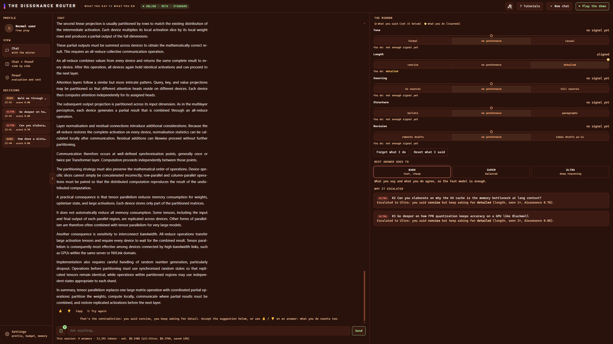
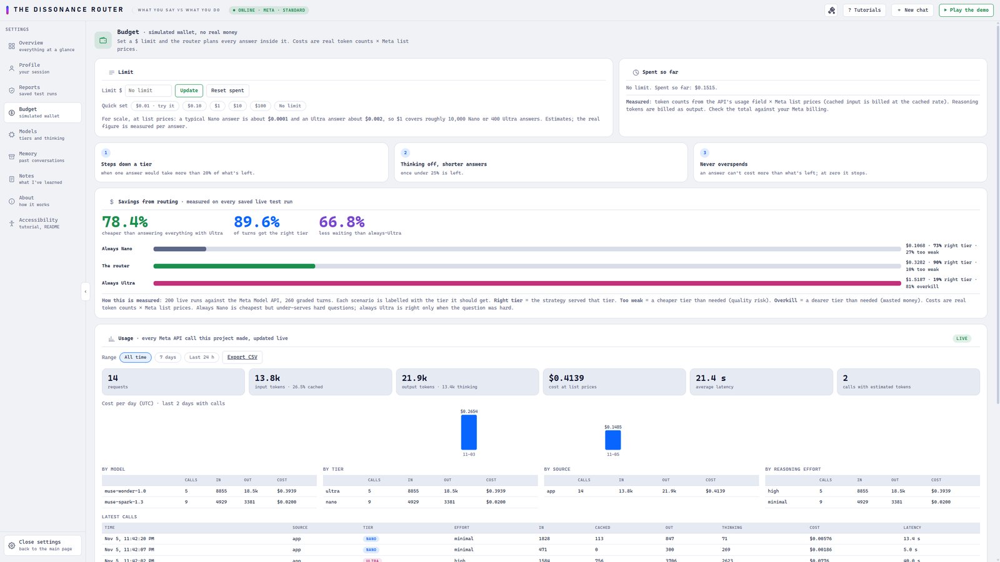
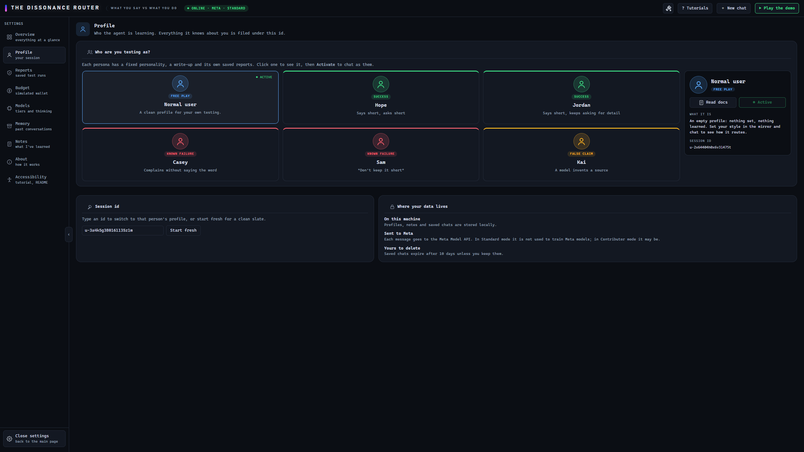
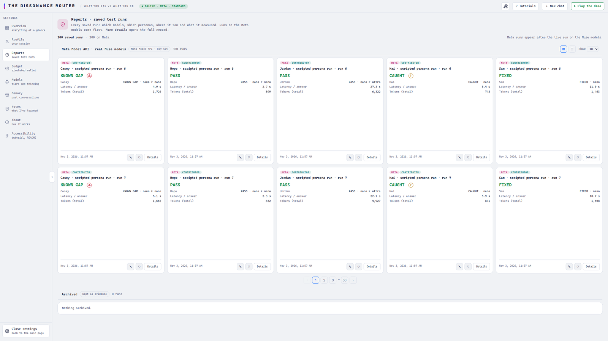
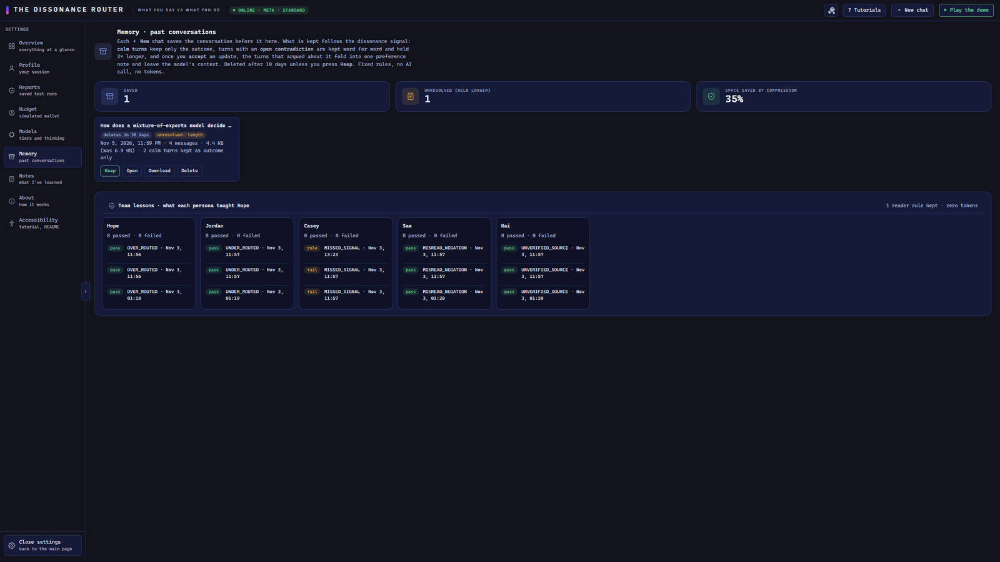
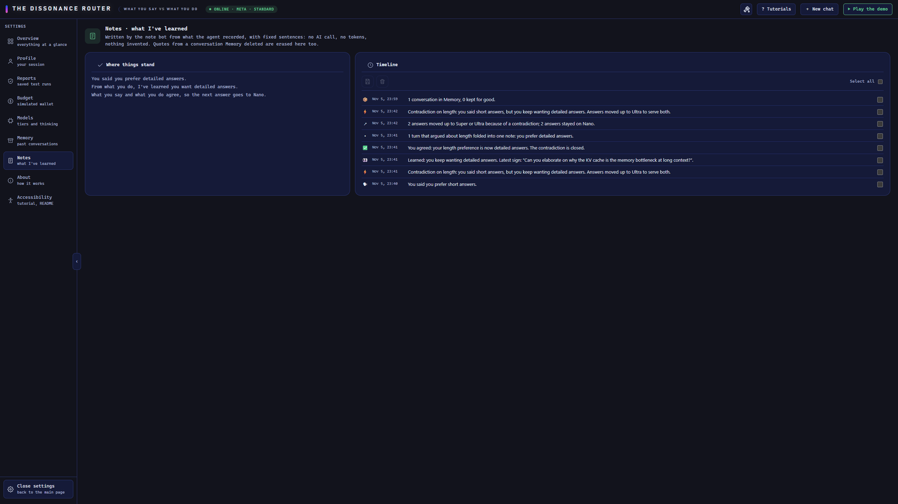
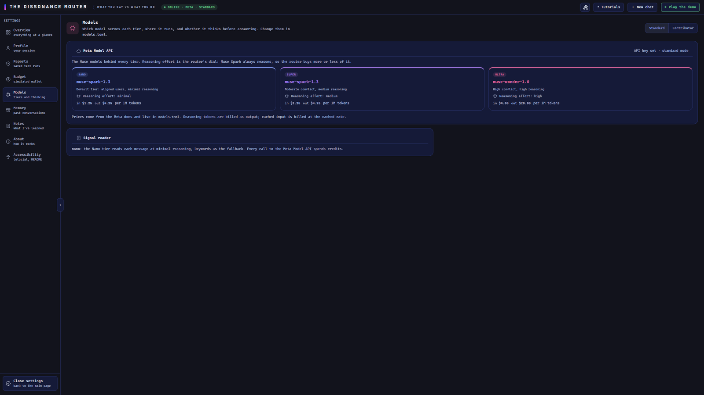

# The Dissonance Router

**An AI agent that notices when what you say you want doesn't match what you do, and spends model power only where that gap exists.**

**Live demo:** https://dissonance-router-meta.onrender.com/ (hosted on a free instance, so the first load after idle can take about 50 seconds; the judges' access code is in the submission).

Built for the Meta Global AI Developer Hackathon (Indie Developer track). Every answer comes from Meta's Muse models through the Meta Model API, and every routing decision is logged with its reason.

*This repository is the Meta version of a project that began as an earlier hackathon entry. The model layer, prices, reasoning control, reports and interface were rebuilt for Meta's models, and no earlier results are included.*

<p align="center">
  
</p>
<p align="center"><em>The user said <strong>concise</strong> but keeps asking for <strong>detail</strong>. The router escalates to Ultra and shows why (right panel).</em></p>

---

## At a glance

Measured on 200 live scenario runs against the Meta Model API (260 graded turns), compared with sending every message to a single tier:

| Result | Value |
|---|---|
| Cheaper than always using Ultra | **78.4%** |
| Turns served by the right tier | **89.6%** (always-Nano 73.1%, always-Ultra 19.2%) |
| Less waiting than always using Ultra | **66.8%** |
| Blind comparisons where Nano was as good as Ultra | **60%** (36 of 60), at a median **1/6.8** of the cost |
| Live runs saved as evidence | **300**, for **$1.18** in total |
| Automated tests (no network needed) | **356** |

---

## Screenshots

<table>
  <tr>
    <td width="50%"><br><sub><b>Savings.</b> The router against always-Nano and always-Ultra, plus a live usage ledger.</sub></td>
    <td width="50%"><br><sub><b>Personas.</b> Five scripted users, including known failures that are shown, not hidden.</sub></td>
  </tr>
  <tr>
    <td width="50%"><br><sub><b>Evidence.</b> Every saved run, with its outcome, latency and tokens.</sub></td>
    <td width="50%"><br><sub><b>Memory.</b> A conversation with an open contradiction is kept longer; calm turns keep only the outcome.</sub></td>
  </tr>
  <tr>
    <td width="50%"><br><sub><b>Notes.</b> What the agent learned and why, written with fixed sentences and no tokens.</sub></td>
    <td width="50%"><br><sub><b>Models.</b> The Muse model, reasoning effort and price behind each tier.</sub></td>
  </tr>
</table>

The app ships with nine themes ([preview](docs/images/themes.png)).

---

## Contents

1. [The problem](#the-problem)
2. [How it works](#how-it-works)
3. [What makes it different](#what-makes-it-different)
4. [Results](#results)
5. [Built on the Meta Model API](#built-on-the-meta-model-api)
6. [Quick start](#quick-start)
7. [Using the app](#using-the-app)
8. [Features](#features)
9. [Design guidelines](#design-guidelines)
10. [Evaluation and reports](#evaluation-and-reports)
11. [HTTP API](#http-api)
12. [Configuration](#configuration)
13. [Project layout](#project-layout)
14. [Known limitations](#known-limitations)
15. [License](#license)

---

## The problem

Most assistants store "I prefer short answers" and treat it as a fact. People often do the opposite: they keep asking for more detail, request rewrites, or ignore the brief reply. The assistant keeps missing, and nothing tells it so.

Model routers usually pick a model by how hard the *question* looks. That ignores the person asking. A simple question from someone whose words and behaviour disagree is exactly where a cheap answer is most likely to miss.

**The Dissonance Router picks a model by how uncertain the agent is about you.**

---

## How it works

The agent keeps two profiles per user across five dimensions: **tone, length, sourcing, structure** and **revision**.

| Profile | Source |
|---|---|
| **Stated** | What you told it you prefer |
| **Observed** | What it learned from how you actually ask and react |

When the two disagree, that disagreement is the signal.

### 1. Learn from words and from behaviour

- **Words.** The Nano tier reads each message for style requests, in any language ("I'm still lost", "short version please"). It must quote your exact words as evidence, or nothing is learned. Words inside quotation marks belong to someone else and don't count.
- **Behaviour.** What you *do* with an answer: 👍, 👎 with a reason ("too long"), Copy, or Try again.
- **Habits, not remarks.** A value only becomes a habit when it repeats recently. Recent turns weigh more and old habits fade, so one offhand comment changes nothing.

### 2. Score the conflict

Each dimension gets a score from 0 to 1:

| Situation | Score |
|---|---|
| Stated and observed agree, or nothing observed yet | 0.00 |
| A preference is emerging that was never stated | 0.40, rising to 0.65 |
| Opposite poles (stated *concise*, observed *detailed*) | 0.70, rising to 0.80 / 0.90 / 0.95 as it repeats |

### 3. Route to a tier

The strongest single contradiction decides the tier. The average is not used, because one clear contradiction averages to 0.14 across five dimensions and would never escalate.

| Score | Tier | Reason |
|---|---|---|
| Below 0.40 | **Nano** | No conflict: the fast, cheap model is enough |
| 0.40 to 0.70 | **Super** | A preference is emerging |
| 0.70 and above | **Ultra** | The agent is unsure what you want, so the answer matters |

### 4. Reconcile

On an Ultra escalation the model is told about the contradiction and asked to serve both sides, for example a one-line summary for the "concise" you said, followed by the depth you keep asking for.

### 5. Explain and ask

Every decision is logged in plain words, for example *"you said 'concise', you behave 'detailed', seen 3×, score 0.90"*. The agent then offers to update your stated preference. Accepting closes the conflict, and it can be undone.

---

## What makes it different

### Routing by the person, not the prompt

The same question can go to different tiers for different people. The router spends more only when the agent's model of *you* is in doubt, and says why every time.

### Conflict-aware memory

What the agent remembers follows the same dissonance signal, not just age:

| Turn | What is kept |
|---|---|
| **Calm** (no contradiction) | Only the outcome: the question, the tier that answered and the answer's length |
| **Open contradiction** | Every word, marked *unresolved*, with the conversation held **3× longer** (30 days instead of 10) |
| **Settled** (you accepted the update) | Folded into one preference note, and removed from the model's context |

This uses fixed rules: no model call and no tokens. Words that are dropped leave the database too, and your Delete button always wins.

### Everything is measured

- A **usage ledger** records every Meta API call as it finishes: tokens, cached tokens, thinking tokens, cost and latency. Message text is never stored.
- A **savings card** compares the router with always-Nano and always-Ultra across every saved live run.
- The **predicted** cost of each answer is shown next to its **measured** cost.

---

## Results

All figures come from runs saved in [`docs/reports/`](docs/reports/), and the app recomputes them live. Of the 200 scenario runs, 180 used Contributor mode and 20 used Standard mode.

### Router against single-tier strategies

Each scenario turn is labelled with the tier it should get. *Right tier* means a strategy served that tier. *Too weak* means a cheaper tier than needed (a quality risk). *Overkill* means a more expensive tier than needed (wasted money).

| Strategy | Cost | Right tier | Too weak | Overkill |
|---|---|---|---|---|
| Always Nano | $0.107 | 73.1% | 26.9% | 0% |
| **The router** | **$0.328** | **89.6%** | **10.4%** | **0%** |
| Always Ultra | $1.519 | 19.2% | 0% | 80.8% |

Always-Nano is cheaper but under-serves hard questions. Always-Ultra is right only when the question is hard. The router sits between them on cost and beats both on fit.

### Is Ultra worth it? A blind comparison

Nano and Ultra answered the same 60 prompts. The Super tier judged each pair without knowing which answer came from which model.

| Outcome | Count |
|---|---|
| Ultra better | 24 (40%) |
| Nano better | 19 (32%) |
| Tie | 17 (28%) |

Nano was as good as or better than Ultra in **60%** of cases, at a median **1/6.8** of the cost. That is the case for escalating only when there is a reason to.

### Latency

Median time per answer, from the same runs:

| Tier | Standard mode | Contributor mode |
|---|---|---|
| Nano | 2.0 s | 3.7 s |
| Super | 9.3 s (one sample) | 23.2 s |
| Ultra | 24.7 s | 40.4 s |

Ultra is slower because it reasons before answering. That is the cost the router avoids whenever it can.

---

## Built on the Meta Model API

Every tier is a Muse model served by the [Meta Model API](https://dev.meta.ai/docs/overview), an OpenAI-compatible Chat Completions endpoint at `https://api.meta.ai/v1`. The models share a 1M-token context window, so the router's real dial is **reasoning effort**: how much thinking it pays for on each request.

| Tier | Model (Standard mode) | Reasoning effort | Used when |
|---|---|---|---|
| Nano | `muse-spark-1.3` | minimal | Words and behaviour agree. Also reads every message for style requests |
| Super | `muse-spark-1.3` | medium | A preference is emerging |
| Ultra | `muse-wonder-1.0` (preview) | high | A clear contradiction |

**Meta Model API features used**

| Feature | How the router uses it |
|---|---|
| `reasoning_effort` | The main routing dial: minimal, medium or high per tier, lowered further when the budget is tight |
| `max_completion_tokens` | Caps each answer so it can never cost more than the remaining budget, with room left for reasoning |
| Streaming with `include_usage` | Measures time to first token and reads exact token counts, including cached and reasoning tokens |
| `prompt_cache_key` | A stable key per tier, so repeated system prompts are billed at the cached rate |
| Standard and Contributor modes | Switchable in Settings → Models. Contributor is cheaper but lets Meta use your content for training, so the app asks first |

**Notes**

- **Reasoning is always on.** Muse Spark rejects `reasoning_effort: none`, so "thinking off" means `minimal`. Reasoning tokens are billed as output.
- **Prices** per 1M tokens: Muse Spark $1.25 in / $4.25 out (cached $0.15); Muse Wonder $4.00 / $20.00 (cached $0.20); Contributor $0.10 / $0.20. They live in [`models.toml`](models.toml).
- **Contributor Ultra.** Muse Wonder has no Contributor mode, so the Contributor Ultra tier is Muse Spark at `xhigh`.
- **Only accepted parameters are sent.** `temperature` is sent only when a caller asks for it.

---

## Quick start

**Requirements:** Python 3.11 or later, and a Meta Model API key from [dev.meta.ai](https://dev.meta.ai).

```bash
python -m venv venv
venv\Scripts\activate            # Windows. On macOS/Linux: source venv/bin/activate
pip install -r requirements.txt
copy .env.example .env           # cp on macOS/Linux, then set MODEL_API_KEY in .env
```

**Start the app**

```bash
python -m src.main               # then open http://127.0.0.1:8000
```

**Run the tests** (no model calls, no key needed)

```bash
python -m pytest
```

**Use it from the terminal**

```bash
python -m src.cli set me stated length concise                         # you say you want short answers
python -m src.cli chat me "Explain how attention works, in more detail please"
python -m src.cli chat me "Can you elaborate on the softmax scaling?"  # contradiction: escalates
python -m src.cli profile me
python -m src.cli accept me length                                     # adopt the observed preference
```

Step-by-step instructions for every test run and the report format are in [docs/RUNNING.md](docs/RUNNING.md).

---

## Using the app

The app is a single page with three views, chosen from the left sidebar or with `/?view=chat|both|proof`.

| View | What it shows |
|---|---|
| **Chat** | Each answer tagged with the model that wrote it, with the reason when it escalated. The mirror on the right shows what you said against what you do |
| **Proof** | The evaluation report: successes, known failures with reason codes, false-claim checks, and cost against fit |
| **Chat + Proof** | Both side by side |

**▶ Play the demo** runs the core contradiction in about a minute with real model calls. A guided tour starts on the first visit, and **? Tutorials** explains every button.

**Settings**

| Tab | Purpose |
|---|---|
| Overview | Everything at a glance |
| Profile | Your session, and the scripted demo personas |
| Reports | Every saved test run, with full details |
| Budget | Spending limit, savings from routing, and live usage |
| Models | Which model serves each tier, and the Standard / Contributor switch |
| Memory | Past conversations and what was kept |
| Notes | What the agent learned about you, and why |
| About | How it works |
| Accessibility | The tour, this README and the theme picker |

---

## Features

### The mirror

Each style dimension is shown as a spectrum: a ring for what you said and a dot for what you do, with the gap glowing as the contradiction grows. Click a word to change your stated preference. When the agent suggests adopting a habit, a one-click **Yes, update it** appears, with Undo.

### Budget, savings and usage

Settings → Budget holds three cards.

- **Limit.** A simulated wallet: real token counts × Meta list prices, with no real money. If the tier the router wants would take more than 20% of what's left, it steps down a tier and says so. Under 25% left, reasoning drops to minimal and answers get shorter. An answer can never cost more than what's left.
- **Savings from routing.** The router against always-Nano and always-Ultra, added up across every saved live run.
- **Usage.** Every Meta API call this project made: requests, input and cached tokens, output and thinking tokens, cost, latency, a cost-per-day chart, breakdowns by model, tier, source and effort, and the latest calls. It refreshes every 3 seconds, filters by time range and exports to CSV.

### Memory

**＋ New chat** saves the conversation you're leaving and starts a clean thread. Your profile stays, because a new chat isn't a new person.

- Saved conversations follow the conflict-aware rules described [above](#conflict-aware-memory).
- Each one is deleted after 10 days (30 if a contradiction is still open) unless you press **Keep**.
- Each card shows its badges (*unresolved*, *folded into a note*), its size before and after compression, and buttons to Keep, Open, Download or Delete.
- Three days before a deletion the chat reminds you, at most once a day.

### Note bot

The square button left of the message box keeps notes on what the agent learned and why. For example: *"You said you prefer short answers"*, *"Learned: you keep wanting detailed answers"*, or *"2 turns that argued about length folded into one note"*.

Notes are written from records the agent already keeps, using fixed sentences. They use **no tokens** and invent nothing.

### Personas and Hope

Five scripted demo users, each replayable with one click. The script is fixed, and the answers come from the real models.

| Persona | Behaviour | Expected outcome |
|---|---|---|
| **Hope** | Says short, asks short | Success: every answer stays on Nano |
| **Jordan** | Says short, keeps asking for detail | Success: the contradiction escalates |
| **Casey** | Complains without style words | Known gap: the complaint can be missed |
| **Sam** | Says "don't keep it short" | Known gap: the negation can be misread |
| **Kai** | A model invents a source | The planted false link is flagged |

When a demo fails, **Hope** reviews it without a model call: why it failed, a proposed fix checked against the failing message, and an optional kept rule the signal reader uses from then on.

### Themes and accessibility

Nine themes, chosen from the **brush button** in the top bar or in Settings → Accessibility. **Deep Meta** is the default. Each theme square shows its colours and the three tier colours. The choice is remembered in the browser.

### Public demo mode

Set `PUBLIC_DEMO=1` for a hosted link. It enables random private session ids, a per-IP rate limit, output caps per tier, a daily spending cut-off and an optional access code. Limits are kept in memory, which suits a single-instance demo but not production.

---

## Design guidelines

Six rules, each enforced in code and checked by its own test ([details](docs/GUIDELINES.md)):

1. **Words are claims, behaviour is evidence.** Neither wins automatically; only you change what you said.
2. **Weak signals teach nothing, and old ones fade.** A habit needs repeats; recent messages weigh more.
3. **This turn's instruction beats the profile, for this turn.** "Keep it short" is obeyed now, and learned only if repeated.
4. **Spend power where it matters.** Greetings, thanks and quick lookups stay on Nano whatever the profile says.
5. **Explain every choice, never change a preference silently.** Adopting a habit needs your yes and can be undone.
6. **Be honest and keep it private.** Say when something failed or isn't known, and never invent sources.

---

## Evaluation and reports

The evaluation runs 20 scripted conversations in three groups: scenarios that should succeed, known failures that must hit the expected reason code, and held-out scenarios. It also checks every explanation the agent gives against its own database: all seven injected false claims must be caught.

```bash
python -m src.eval                     # scripted run, no model calls
python -m src.eval --live --save       # live run on the Meta models, saved as a report
python -m src.eval compare --save      # blind Nano-versus-Ultra comparison
python -m src.eval.demos --save        # one report per persona
```

Every saved run appears as a card in Settings → Reports and on the Proof page, with full details: every turn, tier, token count, cost and reason code. Method and limits are in [docs/EVAL.md](docs/EVAL.md).

---

## HTTP API

Served by the same app. Interactive documentation is at `/docs`.

| Area | Method and path | Purpose |
|---|---|---|
| Chat | `POST /chat` | Answer, chosen tier, reason, conflict scores and stats |
| | `POST /regenerate` | Another answer to the last message (counts as a rejected draft) |
| | `POST /feedback` | 👍, 👎 with reason, or Copy on an answer |
| Profile | `GET /profiles/{user_id}` | Stated and observed profiles, live scores, next tier |
| | `POST /update-style` | Set a stated preference |
| | `POST /accept` | Adopt the observed value; returns what memory folded |
| | `GET /decision-log/{user_id}` | Recent routing decisions with reasons |
| Memory | `POST /conversations/new` | Save the current chat and start a new one |
| | `GET /memory/{user_id}` | Saved conversations with badges and days left |
| | `GET /memory/{user_id}/{id}` | One saved transcript (`/download` for the file) |
| | `POST /memory/keep` · `DELETE /memory/{user_id}/{id}` | Keep or delete |
| Budget | `GET /budget/{user_id}` · `POST /budget` | Read or set the spending limit |
| | `GET /savings` | Router against always-Nano and always-Ultra |
| | `GET /usage?days=N` · `GET /usage.csv` | Live usage ledger, or its CSV export |
| Evidence | `GET /reports` · `GET /reports/{id}` | Saved test runs |
| | `GET /proof` | Latest evaluation reports |
| Other | `GET /notes/{user_id}` | Note bot (always 0 tokens) |
| | `GET /health` | Status, and the model serving each tier |

If the model backend is unreachable, `/chat` returns `503` with the reason. If the budget is used up, it returns `402`.

---

## Configuration

Models, reasoning effort and prices for each tier live in [`models.toml`](models.toml), in two profiles (Standard and Contributor). Edit it and restart. Settings in `.env` override it.

| Variable | Purpose | Default |
|---|---|---|
| `MODEL_API_KEY` | Meta Model API key | required |
| `MODE` | `standard` or `contributor` | `standard` |
| `MODEL_NANO`, `EFFORT_NANO`, `PRICE_NANO_IN`, … | Per-tier overrides | from `models.toml` |
| `SIGNAL_EXTRACTOR` | `nano` (model reader) or keywords | `nano` |
| `DB_PATH` · `MEMORY_DIR` | Where data is stored | `data/` |
| `MEMORY_RETENTION_DAYS` | Days before a saved chat is deleted | `10` |
| `PUBLIC_DEMO` | Hosted demo safeguards | off |
| `RATE_LIMIT_PER_MIN` · `DAILY_BUDGET_USD` | Public demo limits | `6` · `1` |
| `DEMO_ACCESS_CODE` | Optional access code for the hosted demo | none |

---

## Project layout

```
src/agent/        profiles, conflict detection, routing, signals, prompts,
                  LLM client, usage ledger, conflict-aware memory, note bot
src/agent/hope.py zero-token failure review and kept reader rules
src/api/          FastAPI routes, request schemas, rate limits
src/db/           SQLite connection, schema and migrations
src/eval/         scenarios, grading with reason codes, false-claim checks, reports
src/web/          the app (a single HTML file)
src/devdash/      local test dashboard
src/cli.py        terminal interface
src/main.py       app entry point
models.toml       Meta models, reasoning effort and prices per tier, in two modes
docs/reports/     300 saved live runs (.json.gz)
docs/images/      screenshots used in this README
tests/            356 unit tests, no network
```

---

## Known limitations

- **Ultra is slow by design.** It reasons before answering: a median of about 25 seconds in Standard mode and 40 seconds in Contributor mode. The very first call of a session can also wait longer while the service warms up.
- **The scenario labels are ours.** "Right tier" means the tier our scenarios label as ideal, not an independent ground truth.
- **Most live runs used Contributor mode** (180 of 200 scenario runs), which is slower than Standard mode.
- **The usage ledger starts when it was added.** Earlier runs are represented by their saved reports, not by itemised calls.
- **The memory saving is about quality, not size.** Settling a contradiction typically removes one to three turns from the context.
- **The Nano reader keeps one request per message**, so "no bullets and be casual" teaches only one of the two. It misses some phrasings rather than guessing.
- **Behaviour signals** cover thumbs, reasons, Copy and Try again, but not yet edits to an answer or reading time.

---

## License

[MIT](LICENSE)
